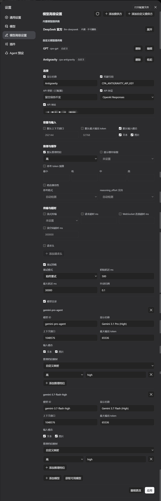

# dsh-advanced-model-editor

一个 DeepSeek Harness WebUI 插件，在「设置」页新增**模型高级配置**区块，用于管理
LLM 提供方配置——覆盖自定义提供方命名空间（`llm-pi-ai`）与官方提供方命名空间
（`llm-deepseek`），包括内置/自定义提供方、模型列表、推理与思考参数、请求头、重试策略等，
并沿用官方设置页的校验与冲突规则。

读写统一走 DSH 的共享设置服务（`ctx.configForms` / `ctx.settingsSchema`），
因此本页面与官方「模型」页共享同一份文档镜像与写队列，不会互相覆盖 revision。
只有对应命名空间真正被服务时该区块才出现；同时展示 DSH 0.2.1 提供的提供方事实——
配置继承的端点（`defaultBaseURL` / `baseURLEnv`）、路由自带认证（`nativeAuth`，含 OAuth）
以及目录诊断信息，免密钥路由不再被误报为「缺少密钥」。



## 环境要求

- **DSH** `>= 0.2.1-rc.2` —— 仅支持当前版本，不提供旧版 DSH 的向后兼容层。
- **Node.js** `^22.19 || >=24`。

---

## 快速安装 (推荐 / 一行命令)

直接通过 GitHub `dist` 分支安装（CI 自动构建产物，无需手动克隆或本地编译）：

```sh
dsh plugin --profile web add github:u9521/dsh-advanced-model-editor#dist
```

安装后**重启 web**（`dsh web`）并**硬刷新浏览器**（Cmd+Shift+R）即可。插件以**模型高级配置**出现在设置页。

### 升级 (远程安装)

通过 `dsh plugin update` 命令即可自动拉取 `dist` 分支的最新发布提交：

```sh
# 升级到最新 dist 版本
dsh plugin --profile web update @local/dsh-advanced-model-editor

# 也可以直接重新 add 最新分支
dsh plugin --profile web add github:u9521/dsh-advanced-model-editor#dist
```

升级后**重启 web** 并**硬刷新浏览器**。

---

## 本地开发与源码构建

### 环境要求

- **务必安装 pnpm**——`npx get-pnpm`（参见 <https://pnpm.io/installation>；也可用
  `corepack enable` 或 `npm install -g pnpm`）。构建与 `dsh plugin --profile web add`
  都需要 pnpm（后者内部会转发给 pnpm 执行）。
- **Node.js** `^22.19 || >=24`。

### 1. 克隆

推荐克隆到 `~/.dsh/plugins/dsh-advanced-model-editor`：

```sh
git clone https://github.com/u9521/dsh-advanced-model-editor.git ~/.dsh/plugins/dsh-advanced-model-editor
cd ~/.dsh/plugins/dsh-advanced-model-editor
```

### 2. 构建

构建产物（`lib/`）不随源码分支提交，本地开发需要自行构建：

```sh
pnpm install
pnpm run build
```

`pnpm run build` 会用项目自身的依赖依次执行 `tsc`（类型检查 + 生成 `lib/types/`）
和 `tsdown`（打包 `lib/index.js` + `lib/client.js`），无需 DSH 源码检出。浏览器产物是
面向 DSH 客户端模块表的自包含闭包工厂，完整的平台模块契约集中在 `tsdown.config.mjs`。

可用以下命令验证构建：

```sh
pnpm test
```

### 3. 本地安装

```sh
dsh plugin --profile web add ~/.dsh/plugins/dsh-advanced-model-editor
```

然后**重启 web**（`dsh web`）并**硬刷新浏览器**（Cmd+Shift+R）。

---

## 开发与维护命令

| 命令 | 说明 |
| :--- | :--- |
| `pnpm run build` | 完整构建（`tsc` 类型检查 + 生成 `lib/` 产物） |
| `pnpm run check` | 仅类型检查（`tsc --noEmit`），不产出文件 |
| `pnpm test` | 先完整构建，再运行测试套件（`node --test`） |
| `pnpm run lint` | 一次跑完 ESLint、类型检查、测试套件与 Prettier 检查（CI 门禁） |
| `pnpm run lint:fix` | 先应用 ESLint 自动修复，再用 Prettier 重写文件 |
| `pnpm run fmt` | 用 Prettier 格式化源码与配置文件 |
| `pnpm run fmt:check` | 检查代码格式是否符合规范 |

---

## 本地源码升级

本地安装时通过软链接（`link:`）方式接入 profile，因此源码升级仅需**拉取最新提交并重新构建**，无需再次执行 `dsh plugin add`：

```sh
cd ~/.dsh/plugins/dsh-advanced-model-editor
git pull
pnpm run build
```

*(若依赖有变动，请在 build 前先执行 `pnpm install`)*

构建完成后**重启 web**（`dsh web`）并**硬刷新浏览器**（Cmd+Shift+R）即可生效。

---

## 卸载

无论是通过 GitHub 快速安装还是通过本地源码链接安装，均通过以下统一命令卸载：

```sh
dsh plugin --profile web remove @local/dsh-advanced-model-editor
```

卸载后重启 web 并硬刷新浏览器。若本地不再需要源码，可手动删除克隆目录：

```sh
rm -rf ~/.dsh/plugins/dsh-advanced-model-editor
```

---

## 许可证

[MIT](LICENSE)
